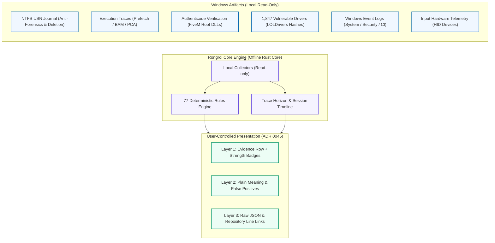

# aeterna-rongroi

<div align="center">

# 🔍 aeterna-rongroi (ร่องรอย)
### Transparent, Offline PC Forensics & Evidence Scanner for FiveM

[](https://github.com/aeterna/aeterna-rongroi/releases)
[](docs/rules-reference.md)
[](PRIVACY.md)
[](LICENSE)
[](docs/adr/0002-no-clean-verdict.md)

**[🌐 Official Website](https://aeterna.github.io/aeterna-rongroi/)** •
**[📖 Screenshare Guide](docs/screenshare-guide.md)** •
**[🔎 77 Rules Reference](docs/rules-reference.md)** •
**[🛡️ Privacy Policy](PRIVACY.md)** •
**[🇹🇭 ภาษาไทย](README.th.md)**

---
</div>

> [!WARNING]
> **Pre-alpha.** The scanner currently implements 77 rules across 12 collector sources. Most rules are experimental and calibrated for research and testing. Never ban a player solely based on these results, and never proclaim a machine is "clean".

**Latest release: [0.12.0](https://github.com/aeterna/aeterna-rongroi/releases/tag/v2026.10.17-0.12.0)**, 17 October 2026.

**An offline, open-source PC-check tool for FiveM communities.** It looks for traces that cheats leave on a Windows PC and for machine settings that make cheating easier, then presents the evidence with full technical provenance. **It never gives a "clean" verdict.**

Players can run it to inspect their own machines, or server staff can review findings over a screenshare (SS) with the player's explicit, informed consent.

*rongroi* (ร่องรอย) is Thai for "traces".

---

## ⚖️ What It Is — And What It Is Not

| It is | It is not |
|---|---|
| An evidence aid for a player checking their own PC, or for staff reviewing with the player's consent | Proof that someone is innocent or guilty |
| A user-mode program that only **reads** local forensic artifacts | A kernel driver, a service, or anything that runs in the background |
| Open: every rule, heuristic, and fixture is public in this repository | Able to see hardware (DMA) cheats or menus hidden from screen capture |
| Offline: our code sends nothing anywhere (CI-enforced) | An online service, a telemetry agent, or a ban list |

---

## 🏗️ Forensic Architecture



---

## 📊 The 3-Layer Evidence Model (ADR 0045)

Every finding is presented in three distinct layers to ensure transparency for both non-technical reviewers and forensic specialists:

1. **Layer 1: The Row Head**
   - Result state: **Found**, **Not found**, or **Not measured** (with reason code).
   - **Strength Badges**: Classifies the weight of evidence based on artifact permanence:
     - `TAMPER` — Evidence of record wiping or anti-forensic disruption.
     - `PRESENCE` — Direct file existence or registry artifact.
     - `EXECUTION` — Evidence that a binary actually ran.
     - `POSTURE` — Machine security setting or hypervisor feature.
     - `CONTEXT` — Informational baseline or temporal marker.

2. **Layer 2: Meaning & Reassurance (False Positives)**
   - What the finding means in plain words.
   - **Ordinary things that produce this**: Legitimate software and system behaviors that trigger the exact same trace, preventing false accusations.
   - Look-back retention horizon for not-found entries.

3. **Layer 3: Technical Details & Code Provenance**
   - Raw key-value observation fields with one-click **Copy raw JSON**.
   - Rule status, collector provenance, and direct clickable links to the exact lines in the open-source repository.

---

## 🛡️ Privacy Guarantee

- **Zero Network Code:** Our code contains no networking dependencies. Continuous-integration checks (`cargo-deny` and network scanners) strictly fail the build if network code is introduced.
- **No Intrusive Surveillance:** No screenshots, no browser history, no remote access, and no memory dumping.
- **SS Mode Consent:** Screenshare (SS) mode asks for informed consent before reading, masks Windows usernames in paths, and allows players to refuse. A player's refusal produces zero inspection.
- **Desktop GUI:** Built with Microsoft WebView2 (the standard Windows component). For zero-WebView environments, the standalone CLI binary (`aeterna-rongroi-cli`) operates purely in user terminal with no GUI components.

Details: [PRIVACY.md](PRIVACY.md).

---

## 🔎 What It Inspects (77 Rules across 12 Collectors)

| Inspection Area | Technical Scope & Forensic Depth |
|---|---|
| **FiveM Integrity** | Authenticode digital signatures of FiveM binaries, add-on `plugins`, `asi` folders, root proxy DLLs (`version.dll`, `dxgi.dll`), and per-server cache structures. |
| **Execution Traces** | Windows Prefetch, BAM (Background Activity Moderator), and PCA (Program Compatibility Assistant). Inspects ephemeral execution (programs run from Temp/Downloads missing on disk). |
| **Anti-Forensics & Log Wiping** | NTFS USN Journal reset / truncation anomalies, digital entitlement wiping, event log clearing, and event file tamper states. |
| **System Security Posture** | Microsoft Defender real-time status, tamper protection, exclusions, UEFI Secure Boot, TPM 2.0, HVCI memory integrity, and test-signing mode. |
| **Vulnerable Drivers** | Compares all registered Windows kernel drivers against **1,847 verified LOLDrivers hashes** (Bring Your Own Vulnerable Driver / BYOVD attacks). |
| **Code Integrity** | Microsoft-Windows-CodeIntegrity Event ID 3033 (blocked driver) and 3077 (revoked driver load) telemetry. |
| **Hardware Telemetry** | Input device connection timestamps (mice and keyboards) mapped to session chronology. |
| **Modified Windows Builds** | Detection of stripped/tweaked Windows distributions (AtlasOS, ReviOS) with disabled security subsystems. |
| **Temporal Look-Back Horizon** | Maps trace horizon bounds so "not found" is never confused with "never occurred". |

---

## 🚀 Verifying a Download

Official release binaries are published with cryptographically verifiable `SHA256SUMS`. To check that your downloaded file is authentic, open Command Prompt (`cmd`) in your download folder:

```bat
for %f in (aeterna-rongroi-*-windows-x64.exe) do @certutil -hashfile %f SHA256
```

Compare the output hash against the `SHA256SUMS` manifest published on the [GitHub Releases](https://github.com/aeterna/aeterna-rongroi/releases) page.

Builds compiled outside the official release pipeline will prominently display an **UNOFFICIAL BUILD** banner in the header.

---

## 📜 Intended Use & Ethics

This project is built to foster fair, transparent, and respectful cheat verification. Contributions designed to evade detection, clean or forge traces, or generate misleading reports are strictly out of scope. See [AGENTS.md](AGENTS.md).

## 📄 License

- Code: **GPL-3.0-or-later** with GPL Section 7 additional terms (attribution, unofficial build marking). See [NOTICE](NOTICE).
- Rules, translations, and fixtures: **CC-BY-SA-4.0**.
