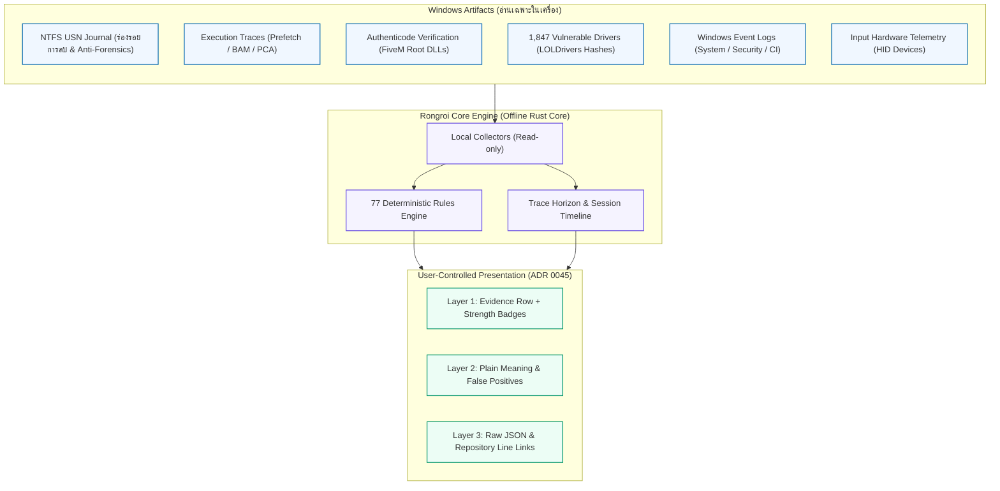

<div align="center">

[🇬🇧 English](README.md) · **ภาษาไทย**

# aeterna-rongroi (ร่องรอย)

### โปรแกรมตรวจเครื่อง (PC Forensics) สำหรับชุมชน FiveM แบบ Open-Source และ Offline

**แสดงหลักฐานตามจริง — ไม่มีวันบอกว่าเครื่อง "สะอาด"**

[](https://github.com/aeterna/aeterna-rongroi/releases)
[](docs/rules-reference.th.md)
[](PRIVACY.md)
[](LICENSE)
[](docs/adr/0002-no-clean-verdict.md)

**[เว็บไซต์ทางการ](https://aeterna.github.io/aeterna-rongroi/) · [คู่มือตรวจแชร์จอ (SS)](docs/screenshare-guide.th.md) · [คู่มืออ้างอิง 77 Rules](docs/rules-reference.th.md) · [นโยบายความเป็นส่วนตัว](PRIVACY.md)**

[เริ่มต้นใช้งาน](#เริ่มต้นใช้งานด่วน) · [คืออะไร / ไม่ใช่อะไร](#คืออะไร--และไม่ใช่อะไร) · [สถาปัตยกรรมนิติวิทยาศาสตร์](#สถาปัตยกรรมนิติวิทยาศาสตร์) · [โมเดลหลักฐาน 3 ชั้น](#โมเดลหลักฐาน-3-ชั้น-adr-0045) · [77 Rules](#ตรวจอะไรบ้าง-77-rules-จาก-12-สายข้อมูล) · [ตรวจสอบไฟล์](#การตรวจสอบความถูกต้องของไฟล์ที่ดาวน์โหลด)

<code>aeterna-rongroi-cli-0.12.0-windows-x64.exe scan --mode ss --lang th</code>

</div>

> [!WARNING]
> **ยังเป็นรุ่นทดลอง (pre-alpha)** ตอนนี้โปรแกรมตรวจด้วย rule ทั้งหมด 77 ตัว จากแหล่งข้อมูล 12 สาย เกือบทั้งหมดยังอยู่ในสถานะทดลอง (experimental) และยังไม่ได้ผ่านการสอบทานกับเครื่องจริงมากพอ ห้ามแบนผู้เล่นโดยอาศัยรายงานนี้เพียงอย่างเดียว และห้ามใช้โปรแกรมนี้เพื่อรับรองว่าเครื่อง "สะอาด"

**รุ่นล่าสุด: [0.12.0](https://github.com/aeterna/aeterna-rongroi/releases/tag/v2026.10.17-0.12.0)**, 17 ตุลาคม 2026.

**โปรแกรมตรวจเครื่อง (PC check) สำหรับชุมชน FiveM แบบ open-source ทำงาน offline** มองหาร่องรอยที่โปรโกงทิ้งไว้บนเครื่อง Windows และการตั้งค่าเครื่องที่เปิดทางให้โกงได้ง่าย แล้วแสดงหลักฐานพร้อมที่มาทางเทคนิคให้คนดู **ไม่มีวันบอกว่าเครื่อง "สะอาด"**

ผู้เล่นสามารถเปิดตรวจเครื่องตัวเองได้ หรือให้แอดมินดูผ่านการแชร์หน้าจอ (SS) โดยผู้เล่นต้องได้รับข้อมูลและให้ความยินยอมก่อนเสมอ

*rongroi* แปลว่า "ร่องรอย" (Traces)

---

## ⚡ เริ่มต้นใช้งานด่วน

### 1. แอปแบบหน้าต่าง Desktop (แนะนำ)
1. ดาวน์โหลดไฟล์ `aeterna-rongroi-0.12.0-windows-x64.exe` จาก [Official Releases](https://github.com/aeterna/aeterna-rongroi/releases)
2. เปิดใช้งานได้ทันที (ไม่ต้องติดตั้ง เป็นไฟล์เดี่ยว portable ทำงาน offline 100% ปลอดภัย)
3. เลือก **ตรวจเครื่องตัวเอง (Self Check)** หรือ **โหมดแชร์หน้าจอ (SS Mode)** สำหรับให้แอดมินตรวจ
4. สลับดูระหว่าง **สรุปภาพรวม (Overview Summary)** สำหรับคนทั่วไปพร้อมปุ่มส่งให้ AI ช่วยวิเคราะห์ และ **รายงานฉบับเต็ม (Detailed Report)** สำหรับหลักฐานเชิงลึก

### 2. แบบบรรทัดคำสั่ง Standalone CLI (สำหรับเครื่องที่ไม่มี WebView)
เปิด Command Prompt (`cmd`) แล้วรัน:
```bat
.\aeterna-rongroi-cli-0.12.0-windows-x64.exe scan --mode self --lang th
```
สำหรับการตรวจผ่านการแชร์หน้าจอพร้อมซ่อน path ผู้ใช้:
```bat
.\aeterna-rongroi-cli-0.12.0-windows-x64.exe scan --mode ss --lang th
```

---

## ⚖️ คืออะไร — และไม่ใช่อะไร

| คือ | ไม่ใช่ |
|---|---|
| ตัวช่วยดูหลักฐาน ให้ผู้เล่นตรวจเครื่องตัวเอง หรือให้แอดมินดูโดยผู้เล่นยินยอม | หลักฐานว่าใครบริสุทธิ์หรือผิด |
| โปรแกรมระดับผู้ใช้ (User-mode) ที่ **อ่านอย่างเดียว** | kernel driver, service หรืออะไรที่แอบรันเบื้องหลัง |
| เปิดเผย: rule และการตรวจทุกตัวอยู่ใน repo นี้ ตรวจสอบได้ทุกบรรทัด | มองเห็นโปรแบบฮาร์ดแวร์ (DMA) หรือเมนูที่ซ่อนจากการแชร์จอ |
| Offline: โค้ดของเราไม่ส่งข้อมูลอะไรออกไปไหนทั้งสิ้น (มี CI ดักตรวจ) | บริการออนไลน์หรือรายชื่อแบน |

---

## 🏗️ สถาปัตยกรรมทางนิติวิทยาศาสตร์คอมพิวเตอร์ (Forensic Architecture)



---

## 📊 โมเดลการแสดงหลักฐาน 3 ชั้น (The 3-Layer Evidence Model, ADR 0045)

ผลการตรวจแต่ละข้อถูกออกแบบให้อ่านง่ายสำหรับผู้เล่นและแอดมินทั่วไป ขณะเดียวกันก็มีข้อมูลเชิงลึกสำหรับผู้เชี่ยวชาญทางเทคนิค:

1. **ชั้นที่ 1: หัวข้อการตรวจ (Row Head)**
   - สถานะของผล: **เจอ (Found)**, **ไม่เจอ (Not found)**, หรือ **ยังไม่ได้วัด (Not measured)** พร้อมรหัสเหตุผล
   - **ป้ายระดับหลักฐาน (Strength Badges)**: บ่งบอกลักษณะของร่องรอยตามหลักนิติวิทยาศาสตร์:
     - `TAMPER` (`ร่องรอยถูกล้าง`) — มีร่องรอยการล้าง log หรือพยายามทำลายหลักฐาน
     - `PRESENCE` (`มีไฟล์อยู่`) — พบไฟล์หรือค่าคอนฟิกตกค้างอยู่จริง
     - `EXECUTION` (`การรันโปรแกรม`) — มีหลักฐานว่าโปรแกรมนั้นเคยถูกรันบนเครื่อง
     - `POSTURE` (`สถานะเครื่อง`) — การตั้งค่าระบบความปลอดภัยของ Windows
     - `CONTEXT` (`ข้อมูลประกอบ`) — บริบทเวลาหรือการตั้งค่าทั่วไป

2. **ชั้นที่ 2: ความหมายและเรื่องปกติ (Meaning & False Positives)**
   - อธิบายว่าข้อนี้หมายถึงอะไรในภาษาที่เข้าใจง่าย
   - **เรื่องปกติที่ทำให้เกิดผลแบบนี้ได้เหมือนกัน**: ระบุโปรแกรมทั่วไปหรือพฤติกรรมปกติของ Windows ที่ทำให้เกิดร่องรอยตรงกัน เพื่อป้องกันการเข้าใจผิดและกล่าวหาผู้เล่นโดยไม่เป็นธรรม
   - แสดงกรอบเวลาที่แหล่งข้อมูลนั้นย้อนดูได้ (Look-back retention) สำหรับข้อที่ไม่เจอ

3. **ชั้นที่ 3: รายละเอียดทางเทคนิคและโค้ดต้นฉบับ (Technical & Code Links)**
   - แสดงข้อมูลดิบ (Observations) ทุก key-value พร้อมปุ่ม **คัดลอก JSON ดิบ**
   - แสดงสถานะ rule, collector ที่ใช้ตรวจ และลิงก์ไปยังไฟล์โค้ดต้นฉบับบน GitHub บรรทัดต่อบรรทัด

---

## 🛡️ การรับประกันความเป็นส่วนตัว (Privacy Guarantee)

- **ไม่มีโค้ดต่อเน็ต 100%:** โค้ดของ aeterna-rongroi ไม่มีส่วนต่อเน็ตเลย และ Continuous Integration (CI) จะปฏิเสธ build ทันทีหากมีการใส่โค้ด network เข้ามา
- **ไม่ละเมิดความเป็นส่วนตัว:** ไม่ถ่ายภาพหน้าจอ ไม่อ่านประวัติเบราว์เซอร์ ไม่มีการรีโมตเข้าเครื่อง และไม่มีการ dump หน่วยความจำ
- **ระบบขอความยินยอมในโหมด SS:** โหมดสำหรับแชร์หน้าจอจะอธิบายว่าจะตรวจอะไรบ้าง และให้ผู้เล่นเป็นคนกดอนุญาตเท่านั้น ผู้เล่นมีสิทธิ์ปฏิเสธ และหากปฏิเสธ โปรแกรมจะไม่แตะต้องข้อมูลใดๆ
- **GUI และ CLI:** รุ่นหน้าต่างใช้ Microsoft WebView2 (ส่วนประกอบมาตรฐานของ Windows) หากผู้ใช้ไม่ต้องการให้มี WebView2 สามารถใช้งานรุ่นบรรทัดคำสั่ง (`aeterna-rongroi-cli`) ซึ่งทำงานบน Terminal 100%

รายละเอียด: [PRIVACY.md](PRIVACY.md)

---

## 🔎 ขอบเขตการตรวจ (77 Rules จาก 12 Collectors)

| หัวข้อการตรวจ | ขอบเขตทางเทคนิคและหลักฐานที่อ่าน |
|---|---|
| **ตัว FiveM เอง** | ตรวจสอบลายเซ็นดิจิทัล (Authenticode), ไฟล์ในโฟลเดอร์ `plugins`, `asi`, DLL ปลอมในโฟลเดอร์หลัก (`version.dll`, `dxgi.dll`), และแคชเซิร์ฟเวอร์ |
| **โปรแกรมที่เคยรัน** | ร่องรอยจาก Prefetch, BAM (Background Activity Moderator), PCA, และตรวจจับโปรแกรมที่เคยรันจากโฟลเดอร์ชั่วคราวแต่ปัจจุบันไฟล์หายไป (Ephemeral Execution) |
| **ร่องรอยการลบบันทึก** | ตรวจจับความผิดปกติของ NTFS Change Journal (USN Truncation / Reset), การลบโฟลเดอร์ DigitalEntitlements, และการเคลียร์ Windows Event Logs |
| **การป้องกันของ Windows** | ตรวจสอบสถานะ Microsoft Defender, การยกเว้นโฟลเดอร์ (Exclusions), UEFI Secure Boot, TPM 2.0, HVCI (Memory Integrity), และโหมด Test-signing |
| **ไดรเวอร์อันตราย** | เปรียบเทียบไดรเวอร์ทั้งหมดที่ลงทะเบียนไว้กับฐานข้อมูล **1,847 แฮชไดรเวอร์อันตรายของ LOLDrivers** (การโจมตีแบบ BYOVD) |
| **ความสมบูรณ์ของโค้ดระบบ** | ตรวจสอบ Event ID 3033 (ไดรเวอร์ถูกบล็อก) และ 3077 (เพิกถอนสิทธิ์ไดรเวอร์) จาก Code Integrity Log |
| **อุปกรณ์เชื่อมต่อ (HID)** | ประวัติและเวลาการเชื่อมต่อเมาส์และคีย์บอร์ดบน Timeline เทียบกับช่วงเวลาเล่นเกม |
| **Windows ที่ถูกดัดแปลง** | ตรวจจับ Windows ปรับแต่งที่ตัดระบบความปลอดภัยออก (เช่น AtlasOS, ReviOS) |
| **กรอบเวลาย้อนหลัง** | ระบุขอบเขตเวลาที่บันทึกยังหลงเหลืออยู่ชัดเจน เพื่อไม่ให้ "ไม่เจอ" ถูกเข้าใจผิดว่า "ไม่เคยเกิดขึ้น" |

---

## 🚀 การตรวจสอบความถูกต้องของไฟล์ที่ดาวน์โหลด

ไฟล์ทางการทุก release จะถูกแนบมาพร้อมกับ `SHA256SUMS` เพื่อให้ตรวจสอบความถูกต้องได้ก่อนรันเสมอ โดยเปิด Command Prompt (`cmd`) ในโฟลเดอร์ที่ดาวน์โหลด แล้วพิมพ์:

```bat
for %f in (aeterna-rongroi-*-windows-x64.exe) do @certutil -hashfile %f SHA256
```

นำค่า hash ที่ได้ไปเทียบกับบรรทัดของไฟล์นั้นใน `SHA256SUMS` บนหน้า [GitHub Releases](https://github.com/aeterna/aeterna-rongroi/releases)

ไฟล์ที่คอมไพล์เองหรือไม่ผ่านระบบ Release ทางการ จะแสดงป้ายเตือน **UNOFFICIAL BUILD** เด่นชัดบนหัวโปรแกรม

---

## 📜 จุดประสงค์การใช้งานและจริยธรรม

โครงการนี้สร้างขึ้นเพื่อสนับสนุนการตรวจสอบที่โปร่งใส เคารพสิทธิ์ และตั้งอยู่บนหลักฐานจริง การดัดแปลงหรือส่งโค้ดที่มีเจตนาช่วยให้โปรโกงหลบเลี่ยงการตรวจ, ช่วยล้างร่องรอย, หรือทำให้รายงานบิดเบือน จะถูกปฏิเสธทันที ดู [AGENTS.md](AGENTS.md)

## 📄 สัญญาอนุญาต (License)

- โค้ด: **GPL-3.0-or-later** ภายใต้ข้อกำหนดเพิ่มเติมของ GPL Section 7 (คงการระบุแหล่งที่มา และระบุชัดเจนหากเป็นรุ่นแก้ไขที่ไม่เป็นทางการ) ดู [NOTICE](NOTICE)
- Rules, คำแปล, และ Fixture: **CC-BY-SA-4.0**
