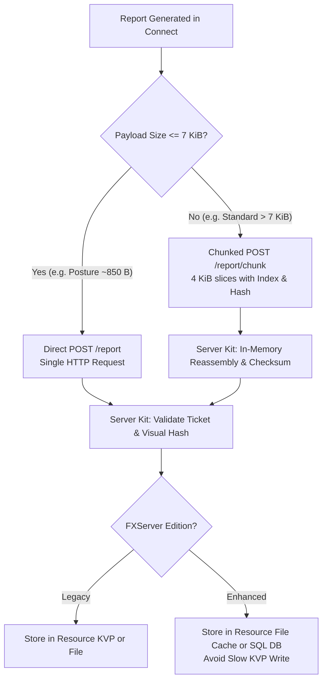

# ADR 0089 — Rongroi product line and schema 2

- Status: proposed — the owner decided the product-line questions Q1–Q23 on 2026-10-28, and PoC Spike W1a reported on 2026-10-31. It becomes accepted when the owner merges this ADR. Spike lanes S2 (NUI file picker), S4 (latent event from a client), S6 (deferrals card) and S11 (other antivirus) have not run; nothing below depends on their results
- Date: 2026-10-31 (revised 2026-11-01)
- Related: ADR 0002 (no verdicts / evidence only), ADR 0007 (official builds and provenance), ADR 0012 (relaunch elevated), ADR 0040 (player controls client machine), ADR 0061 (anchors and trace ages), ADR 0073 (saved reports and schema 1), AGENTS.md hard rule 1 (zero network in aeterna-rongroi), hard rule 3 (evidence, never a verdict), hard rule 9 (no verified badge / no auto-ban)
- Amends: ADR 0073 (extends `SavedRecord` to `schema: 2`, additive and backward-compatible)

## Context

Rongroi was originally designed and built as a single standalone desktop tool: **Rongroi Offline** (Tauri + Rust core). In this mode, players run the application locally or during a screenshare session, review the findings on screen, and optionally export a local saved report JSON (`SavedRecord`, schema 1, ADR 0073) without any network transmission.

### The Problem

Game communities running FiveM servers (both Legacy FXServer and Enhanced FXServer) need a mechanism to verify player system state and investigate suspected game manipulation without forcing players through cumbersome manual screenshares or external third-party file uploads, and without giving server administrators intrusive, unverifiable kernel rootkits.

However, expanding Rongroi to communicate with servers introduces critical security, architectural, and data-sovereignty constraints:

1. **The Zero-Network Boundary (Hard Rule 1):** The core analysis engine and the offline desktop application MUST NOT contain any network code. Players who use Rongroi Offline must remain 100% certain that no data leaves their machine.
2. **The Client Control Boundary (ADR 0040 & Hard Rule 9):** The player controls their own Windows operating system and user-space environment. A client application can be hooked, modified, or replayed. Therefore, **no client can ever issue a "clean" or "verified" verdict.** Reports must consist strictly of objective forensic observations.
3. **The Paired-Origin Isolation Boundary:** If an automated client sends data to a server, it must be cryptographically and strictly bound to the specific server the player agreed to connect to. It must never phone home, send telemetry, or contact unauthorized third-party hosts.
4. **The Runtime Buffer Reality (Spike W1a Empirical Evidence):** PoC Spike W1a measured FXServer HTTP handling and discovered that while Legacy FXServer (master 35245) accepts 1 MiB HTTP payloads in a single request, Enhanced FXServer (early-access b170) enforces a strict **8,192-byte (8 KiB)** buffer limit. Any payload of 8,193 bytes or larger causes Enhanced FXServer to abort the connection with an empty reply (curl error 52).

## Decision

### 1. The Three-Tier Product Line

The Rongroi ecosystem is partitioned into three distinct, decoupled products with clear operational boundaries:

```
┌─────────────────────────────────────────────────────────────┐
│ 1. Rongroi Offline (repo: aeterna/aeterna-rongroi)          │
│    • Tauri desktop app + CLI                                │
│    • Zero network code (Hard Rule 1)                        │
│    • Local inspection & Schema 1 / Schema 2 export          │
└─────────────────────────────────────────────────────────────┘
                               ▲
                               │ shared core crate (read-only)
                               ▼
┌─────────────────────────────────────────────────────────────┐
│ 2. Rongroi Connect (repo: aeterna/aeterna-rongroi-connect)  │
│    • Standalone single-shot Electron client                 │
│    • Sandboxed Chromium UI (User privileges)                │
│    • Rust scan sidecar (rongroi-scan)                       │
│    • Inter-process Communication via Windows Named Pipe     │
│    • Network gate strictly locked to paired server origin   │
└─────────────────────────────────────────────────────────────┘
                               │
                               │ HTTP POST (Single-shot / Chunked)
                               ▼
┌─────────────────────────────────────────────────────────────┐
│ 3. Rongroi Server Kit (repo: aeterna/nakara-oss)            │
│    • FiveM resource: `nakara_rongroi` (MIT)                 │
│    • Operates on Legacy (:30130) & Enhanced (:30140)        │
│    • Issues pairing tickets & server policy                 │
│    • Ingestion: Direct (≤ 7 KiB) or Chunked (> 7 KiB)       │
│    • Rule evaluation, Visual Hash match, staff UI           │
└─────────────────────────────────────────────────────────────┘
```

1. **Rongroi Offline (`aeterna/aeterna-rongroi`):** Remains strictly offline. No network crates in `Cargo.lock`. Produces and reads both Schema 1 and Schema 2 reports.
2. **Rongroi Connect (`aeterna/aeterna-rongroi-connect`):** A lightweight single-shot client (Electron 44 + `rongroi-scan` sidecar). Connect runs with non-elevated user privileges, accepts a pairing code, displays server identity and scan scope, runs the sidecar, displays a visual hash lock, uploads the report to the paired server origin, and immediately exits.
3. **Rongroi Server Kit (`nakara_rongroi` in `aeterna/nakara-oss`):** An open-source FiveM resource that integrates with server frameworks (Qbox, QBCore, ESX, or standalone). It mints short-lived, single-use pairing tickets, receives encrypted reports over HTTP, checks the ticket, nonce, expiry and report hash, and provides in-game staff inspection without automated bans.

### What Connect can and cannot show

The player controls the PC (ADR 0040), so a report from Connect can always be forged or edited before it is encrypted. Nothing in this ADR signs a report, and no part of it may be described as proof that a report is genuine or that a PC is clean (hard rule 9). Connect and Server Kit establish two facts only:

1. **The server received this report after it opened this case** — the report carries the ticket and nonce the server issued, inside the ticket's 300-second window, and the ticket can be used once (section 5).
2. **The report the server holds is the one the player saw** — the server recomputes `visual_hash` from what it received, and staff compare it with the 16 characters on the player's screen (section 2).

---

### 2. Schema 2 (Record Model Evolution in `rongroi-core`)

The top-level saved record (`crates/rongroi-core/src/view/saved.rs`) is upgraded from `schema: 1` to `schema: 2`. The evolution is strictly additive: existing schema 1 records deserialize without error (missing fields default to `None`).

A Schema 2 record has the following shape:

```json
{
  "kind": "rongroi-saved-report",
  "schema": 2,
  "case_code": "7K9M-2X4P",
  "rongroi_version": "0.14.0",
  "official_build": true,
  "producer": {
    "name": "rongroi-connect",
    "version": "0.1.0",
    "mode": "single-shot"
  },
  "binding": {
    "server_origin": "http://203.0.113.10:30130",
    "ticket": "9f82c4e1b07a412891d604e38a291bf0",
    "nonce": "c4b82e91024a",
    "issued_at": "2026-10-31T14:30:00Z",
    "expires_at": "2026-10-31T14:35:00Z"
  },
  "policy": {
    "profile": "posture",
    "required_collectors": [
      "posture",
      "os_image",
      "install_marker",
      "defender_exclusion",
      "net_config",
      "driver_service"
    ],
    "require_elevation": true,
    "policy_hash": "a1b2c3d4e5f60718"
  },
  "visual_hash": "4f8a91bc023e5d71",
  "view": { "...": "Standard view payload as in Schema 1" }
}
```

#### Field Specifications:

* **`producer` (Optional in Schema 1, Required in Schema 2):**
  - `name`: `"rongroi-offline"` or `"rongroi-connect"`
  - `version`: Version string of the producer binary
  - `mode`: `"interactive"` (user navigated UI) or `"single-shot"` (headless automated scan)
* **`binding` (Optional in Schema 1, Present when produced via Connect):**
  - `server_origin`: The exact HTTP/HTTPS origin (`scheme://host:port`) of the paired FiveM server.
  - `ticket`: A 32-character hexadecimal cryptographically secure random token generated by Server Kit.
  - `nonce`: A server-generated challenge nonce to guarantee fresh report generation.
  - `issued_at` & `expires_at`: ISO 8601 UTC timestamps enforcing the maximum ticket lifetime (300 seconds).
* **`policy` (Optional in Schema 1, Present when produced under Server Kit policy):**
  - `profile`: one of three names, each fixing what `required_collectors` may hold:
    - `"posture"` — the collectors behind the rules marked `posture` (machine requirements a server may gate on, Q18). The example above lists them as of this ADR.
    - `"standard"` — the same collectors the Offline app runs in a full scan of the same `rongroi_version`.
    - `"custom"` — a list the server picks from the collector IDs that `rongroi_version` knows. An unknown ID makes Connect refuse the policy before the consent screen.
    Whatever the profile, Connect shows the full collector list on the consent screen, and the record carries the list that ran.
  - `required_collectors`: Array of collector IDs requested by the server and consented to by the player.
  - `require_elevation`: Boolean indicating whether administrator elevation was mandated.
  - `policy_hash`: 16-hex digest of the policy definition.
* **`visual_hash`:**
  - 16 lowercase hexadecimal characters: the first 64 bits of `SHA-256(C)`, where `C` is the record with the `visual_hash` member removed, serialized by the JSON Canonicalization Scheme (RFC 8785) and encoded as UTF-8. Removing the member first keeps the hash from covering itself.
  - Producer and server compute it the same way; the server recomputes it from the decrypted record and stores a mismatch as a fact on the case, never as a verdict.
  - 64 bits is sized for a person comparing two screens, not for collision resistance. Integrity of the upload in transit is checked separately with the full SHA-256 (section 4).
  - Displayed prominently in the Connect window before upload, and displayed on the staff inspection UI and in-game NUI, allowing visual confirmation during screenshares or support reviews.

---

### 3. Connect Security Architecture & IPC Boundary

1. **Separation of Privilege:**
   - The user-facing Electron shell (`rongroi-connect.exe`) runs as a standard, non-elevated user process. It does NOT request or require UAC elevation.
   - When policy requires administrative privileges (specifically for the `defender_exclusion` collector, or standard USN/event collectors), the shell invokes the sidecar (`rongroi-scan.exe`) with the `--elevate` flag using the established `elevate::relaunch_elevated` mechanism (ADR 0012).
   - If the player declines UAC (clicks "No"), the sidecar immediately terminates with exit code 3 (`declined`). Connect intercepts this code and reports `{ "scan": "declined" }` to the server without freezing or timing out.
2. **Local IPC via Windows Named Pipe:**
   - Data transfer between the elevated sidecar and non-elevated Connect occurs strictly in memory over a random named pipe: `\\.\pipe\rongroi-<32hex>`.
   - The pipe security descriptor (ACL) restricts access exclusively to the current user SID and administrative tokens, rejecting remote connections (`PIPE_REJECT_REMOTE_CLIENTS`).
   - No report files are written to `%TEMP%` or `%APPDATA%` (`%TEMP%` writes measured at 0 bytes in Spike W1a).
3. **Network Quarantine (`--fix-net` Enforcement):**
   - In production builds of Connect, Chromium's network stack is quarantined:
     - `no-proxy-server` switch disables WPAD DNS lookups.
     - Spellcheck dictionary download URL is redirected to loopback dummy `127.0.0.1:9`.
     - `webRequest.onBeforeRequest` blocks any outgoing HTTP/HTTPS/WebSocket request whose origin differs from `binding.server_origin`.

---

### 4. Server Ingestion Protocol (Handling the 8 KiB Buffer Limit)

To guarantee flawless report delivery across both Legacy FXServer and Enhanced FXServer, the ingestion protocol implements dual-mode transport:



What travels is the encrypted envelope of section 5, not the plain JSON, and the size test below applies to the envelope.

1. **Small Payload Path (Size &le; 7,168 bytes):**
   - Connect issues a single `POST /<resource>/report` containing the complete envelope, with header `X-Rongroi-Report-Sha256` (64 hex, SHA-256 of the envelope bytes).
   - Fits comfortably within Enhanced FXServer's 8,192-byte buffer limit.
2. **Large Payload Path (Size > 7,168 bytes):**
   - Connect splits the payload into slices of 4,096 bytes (4 KiB).
   - Slices are uploaded sequentially to `POST /<resource>/report/chunk` with headers:
     - `X-Rongroi-Upload-Id`: Pairing ticket.
     - `X-Rongroi-Chunk-Index`: 0-based slice index.
     - `X-Rongroi-Chunk-Total`: Total slice count.
     - `X-Rongroi-Chunk-Sha256`: Hash of current slice.
     - `X-Rongroi-Report-Sha256`: SHA-256 of the whole envelope, the same value on every slice.
   - If any slice fails due to network jitter, Connect retries up to 3 times with exponential backoff (500 ms, 1500 ms, 3000 ms).
   - Server Kit reassembles slices in memory. Reassembly buffers carry a 60-second TTL to prevent memory leaks from abandoned uploads. One upload may be open per ticket; slices for a ticket that has no open upload, or whose `Report-Sha256` differs from the first slice's, are refused.
   - When the last slice arrives, Server Kit checks the SHA-256 of the reassembled envelope against `X-Rongroi-Report-Sha256` before it decrypts. A mismatch drops the buffer and answers `422`; Connect may restart the upload once while the ticket is still valid.
3. **Server-Side Storage Strategy:**
   - **Legacy FXServer:** Reports may be stored in Resource KVP (write latency measured at 17–27 ms).
   - **Enhanced FXServer:** Reports MUST NOT be written synchronously to Resource KVP (write latency measured at 192–222 ms due to SQLite disk sync). Server Kit writes raw reports to the resource cache directory (`server-data/cache/rongroi-reports/<ticket>.json`) or asynchronously into the server database (`oxmysql`).

---

### 5. Pairing, Encryption and the Single-Use Ticket

The owner decided (Q8) that reports are encrypted at the message level with a key of the Server Kit that travels inside the pairing code, and that Cfx's HTTPS is used only if the spike shows it works. Spike W1a did not test HTTPS through `users.cfx.re` (S1 fell back to message-level encryption only), so v1 sends the encrypted envelope over plain HTTP to `server_origin`.

1. **Server Kit key pair:** Server Kit creates an X25519 key pair when it first starts and keeps the private key in its own resource storage. The private key never leaves the server.
2. **Pairing code:** when staff open a case (or at a deferrals check), Server Kit shows the player a code in game: `rr1.` followed by base64url of a small JSON object holding `server_origin`, `ticket`, `nonce`, `expires_at`, `policy_hash` and the Kit's public key. The player copies and pastes it; it is not meant to be typed. Because the code reaches the player inside the game, a party on the network path cannot swap the key without also controlling the game client.
3. **Policy fetch:** Connect reads the policy with `GET /<resource>/policy/<ticket>` from `server_origin` — the first request it makes — and refuses it unless its digest equals `policy_hash` from the code. `policy_hash` is the first 64 bits of SHA-256 over the RFC 8785 serialization of the `policy` object without its `policy_hash` member. The consent screen shows `server_origin`, the server name from the policy and the full collector list before anything runs.
4. **Envelope:** Connect creates a fresh X25519 key pair per report, derives a key with HKDF-SHA256 (salt = ticket, info = `rongroi-connect report v1`) and encrypts the UTF-8 record with AES-256-GCM, with the ticket as additional data. The envelope is `{ "v": 1, "epk": …, "iv": …, "ct": … }` (base64url members). Node's `crypto` module is present in both FXServer editions (S3); X25519 and AES-GCM specifically were not exercised in the spike and are checked first in W2.
5. **Single-use ticket:** a ticket moves `issued → uploading → consumed`, or to `expired`. Server Kit accepts the first `POST /report` or first chunk only while the ticket is `issued` and the server's clock is before `expires_at`; an upload that started in time may finish within the 60-second reassembly TTL. The nonce in the record must equal the one issued with the ticket. An accepted report, or a `{ "scan": "declined" }` answer, consumes the ticket; any later upload for it gets `409` and is logged on the case. Staff open a new case to scan again.

---

## Consequences

### Positive
- **Integrity of Offline Preserved:** `aeterna-rongroi` maintains its zero-network invariant.
- **Cross-Edition Compatibility:** Works seamlessly across both GTA5 Legacy and GTA5Enhanced FXServer without hitting buffer truncation.
- **Traceability, not proof:** the ticket, nonce and `visual_hash` let staff tie a report to the case they opened and to what the player saw on screen. They do not show that the report is genuine; the player can still forge it (section 1, "What Connect can and cannot show").
- **Fast Execution:** Posture scan flow completes end-to-end in ~1.3 seconds.

### Negative & Mitigations
- **Binary Footprint:** Electron packaging adds ~158 MB (compressed zip) for the Connect client. Mitigation: distributed as a portable zip archive with fast extraction (6.4 s).
- **Unsigned releases and SmartScreen:** a file downloaded in a browser carries the Mark-of-the-Web, and SmartScreen warns on such a file until it has reputation; since August 2024 an EV certificate no longer grants that reputation at once (`docs/research/05-oss-rust-tauri-repo-practices.md`). Spike S10 copied the exe over scp, without the mark, so the browser-download path is untested. Rongroi Offline ships unsigned today and its guide tells players to click **More info → Run anyway** (`docs/screenshare-guide.md`); Connect 0.1.0 pre-alpha follows the same path. Signing through SignPath Foundation waits for a second maintainer who can act as release approver (`GOVERNANCE.md`); a paid certificate is an owner decision.
- **Encryption without HTTPS:** v1 hides report content with the envelope of section 5, but the request line and headers (resource path, ticket, sizes) travel in clear over HTTP.
