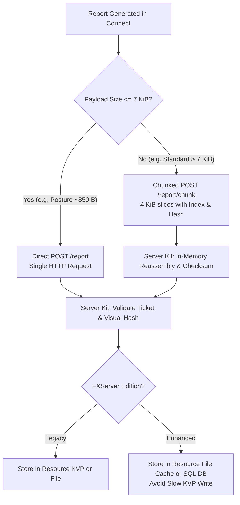

# ADR 0089 — Rongroi product line and schema 2

- Status: accepted — the owner decided the product-line questions Q1–Q23 on 2026-10-28 and approved the PoC Spike W1a findings on 2026-10-31
- Date: 2026-10-31
- Related: ADR 0002 (no verdicts / evidence only), ADR 0007 (official builds and provenance), ADR 0012 (relaunch elevated), ADR 0040 (player controls client machine), ADR 0061 (anchors and trace ages), ADR 0073 (saved reports and schema 1), AGENTS.md hard rule 1 (zero network in aeterna-rongroi), hard rule 3 (evidence, never a verdict), hard rule 9 (no verified badge / no auto-ban)
- Amends: ADR 0073 (extends `SavedRecord` to `schema: 2`, additive and backward-compatible)

## Context

Rongroi was originally designed and built as a single standalone desktop tool: **Rongroi Offline** (Tauri + Rust core). In this mode, players run the application locally or during a screenshare session, review the findings on screen, and optionally export a local saved report JSON (`SavedRecord`, schema 1, ADR 0073) without any network transmission.

### The Problem

Game communities running FiveM servers (both Legacy FXServer and Enhanced FXServer) need a mechanism to verify player system state and investigate suspected game manipulation without forcing players through cumbersome manual screenshares or external third-party file uploads, and without giving server administrators intrusive, unverifiable kernel rootkits.

However, expanding Rongroi to communicate with servers introduces critical security, architectural, and data-sovereignty constraints:

1. **The Zero-Network Boundary (Hard Rule 1):** The core analysis engine and the offline desktop application MUST NOT contain any network code. Players who use Rongroi Offline must remain 100% certain that no data leaves their machine.
2. **The Client Control Boundary (ADR 0040 & Hard Rule 9):** The player controls their own Windows operating system and user-space environment. A client application can be hooked, modified, or replayed. Therefore, **no client can ever issue a "clean" or "verified" verdict.** Reports must consist strictly of objective forensic observations.
3. **The Paired-Origin Isolation Boundary:** If an automated client sends data to a server, it must be cryptographically and strictly bound to the specific server the player agreed to connect to. It must never phone home, send telemetry, or contact unauthorized third-party hosts.
4. **The Runtime Buffer Reality (Spike W1a Empirical Evidence):** PoC Spike W1a measured FXServer HTTP handling and discovered that while Legacy FXServer (master 35245) accepts 1 MiB HTTP payloads in a single request, Enhanced FXServer (early-access b170) enforces a strict **8,192-byte (8 KiB)** buffer limit. Any payload of 8,193 bytes or larger causes Enhanced FXServer to abort the connection with an empty reply (curl error 52).

## Decision

### 1. The Three-Tier Product Line

The Rongroi ecosystem is partitioned into three distinct, decoupled products with clear operational boundaries:

```
┌─────────────────────────────────────────────────────────────┐
│ 1. Rongroi Offline (repo: aeterna/aeterna-rongroi)          │
│    • Tauri desktop app + CLI                                │
│    • Zero network code (Hard Rule 1)                        │
│    • Local inspection & Schema 1 / Schema 2 export          │
└─────────────────────────────────────────────────────────────┘
                               ▲
                               │ shared core crate (read-only)
                               ▼
┌─────────────────────────────────────────────────────────────┐
│ 2. Rongroi Connect (repo: aeterna/aeterna-rongroi-connect)  │
│    • Standalone single-shot Electron client                 │
│    • Sandboxed Chromium UI (User privileges)                │
│    • Rust scan sidecar (rongroi-scan)                       │
│    • Inter-process Communication via Windows Named Pipe     │
│    • Network gate strictly locked to paired server origin   │
└─────────────────────────────────────────────────────────────┘
                               │
                               │ HTTP POST (Single-shot / Chunked)
                               ▼
┌─────────────────────────────────────────────────────────────┐
│ 3. Rongroi Server Kit (repo: aeterna/nakara-oss)            │
│    • FiveM resource: `nakara_rongroi` (MIT)                 │
│    • Operates on Legacy (:30130) & Enhanced (:30140)        │
│    • Issues pairing tickets & server policy                 │
│    • Ingestion: Direct (≤ 7 KiB) or Chunked (> 7 KiB)       │
│    • Rule evaluation, Visual Hash match, staff UI           │
└─────────────────────────────────────────────────────────────┘
```

1. **Rongroi Offline (`aeterna/aeterna-rongroi`):** Remains strictly offline. No network crates in `Cargo.lock`. Produces and reads both Schema 1 and Schema 2 reports.
2. **Rongroi Connect (`aeterna/aeterna-rongroi-connect`):** A lightweight single-shot client (Electron 44 + `rongroi-scan` sidecar). Connect runs with non-elevated user privileges, accepts a pairing code, displays server identity and scan scope, runs the sidecar, displays a visual hash lock, uploads the report to the paired server origin, and immediately exits.
3. **Rongroi Server Kit (`nakara_rongroi` in `aeterna/nakara-oss`):** An open-source FiveM resource that integrates with server frameworks (Qbox, QBCore, ESX, or standalone). It mints short-lived pairing tickets, receives reports over HTTP, validates cryptographic signatures/hashes, and provides in-game staff inspection without automated bans.

---

### 2. Schema 2 (Record Model Evolution in `rongroi-core`)

The top-level saved record (`crates/rongroi-core/src/view/saved.rs`) is upgraded from `schema: 1` to `schema: 2`. The evolution is strictly additive: existing schema 1 records deserialize without error (missing fields default to `None`).

A Schema 2 record has the following shape:

```json
{
  "kind": "rongroi-saved-report",
  "schema": 2,
  "case_code": "7K9M-2X4P",
  "rongroi_version": "0.14.0",
  "official_build": true,
  "producer": {
    "name": "rongroi-connect",
    "version": "0.1.0",
    "mode": "single-shot"
  },
  "binding": {
    "server_origin": "http://127.0.0.1:30120",
    "ticket": "9f82c4e1b07a412891d604e38a291bf0",
    "nonce": "c4b82e91024a",
    "issued_at": "2026-10-31T14:30:00Z",
    "expires_at": "2026-10-31T14:35:00Z"
  },
  "policy": {
    "profile": "posture",
    "required_collectors": [
      "posture",
      "os_image",
      "install_marker",
      "defender_exclusion",
      "net_config",
      "driver_service"
    ],
    "require_elevation": true,
    "policy_hash": "a1b2c3d4e5f60718"
  },
  "visual_hash": "4f8a91bc023e5d71",
  "view": { "...": "Standard view payload as in Schema 1" }
}
```

#### Field Specifications:

* **`producer` (Optional in Schema 1, Required in Schema 2):**
  - `name`: `"rongroi-offline"` or `"rongroi-connect"`
  - `version`: Version string of the producer binary
  - `mode`: `"interactive"` (user navigated UI) or `"single-shot"` (headless automated scan)
* **`binding` (Optional in Schema 1, Present when produced via Connect):**
  - `server_origin`: The exact HTTP/HTTPS origin (`scheme://host:port`) of the paired FiveM server.
  - `ticket`: A 32-character hexadecimal cryptographically secure random token generated by Server Kit.
  - `nonce`: A server-generated challenge nonce to guarantee fresh report generation.
  - `issued_at` & `expires_at`: ISO 8601 UTC timestamps enforcing the maximum ticket lifetime (300 seconds).
* **`policy` (Optional in Schema 1, Present when produced under Server Kit policy):**
  - `profile`: `"posture"` (standard pre-join checks), `"standard"` (full evidence suite), or `"custom"`.
  - `required_collectors`: Array of collector IDs requested by the server and consented to by the player.
  - `require_elevation`: Boolean indicating whether administrator elevation was mandated.
  - `policy_hash`: 16-hex digest of the policy definition.
* **`visual_hash`:**
  - 16-character hexadecimal string representing the first 64 bits of `SHA-256(canonical_report_json)`.
  - Displayed prominently in the Connect window before upload, and displayed on the staff inspection UI and in-game NUI, allowing visual confirmation during screenshares or support reviews.

---

### 3. Connect Security Architecture & IPC Boundary

1. **Separation of Privilege:**
   - The user-facing Electron shell (`rongroi-connect.exe`) runs as a standard, non-elevated user process. It does NOT request or require UAC elevation.
   - When policy requires administrative privileges (specifically for the `defender_exclusion` collector, or standard USN/event collectors), the shell invokes the sidecar (`rongroi-scan.exe`) with the `--elevate` flag using the established `elevate::relaunch_elevated` mechanism (ADR 0012).
   - If the player declines UAC (clicks "No"), the sidecar immediately terminates with exit code 3 (`declined`). Connect intercepts this code and reports `{ "scan": "declined" }` to the server without freezing or timing out.
2. **Local IPC via Windows Named Pipe:**
   - Data transfer between the elevated sidecar and non-elevated Connect occurs strictly in memory over a random named pipe: `\\.\pipe\rongroi-<32hex>`.
   - The pipe security descriptor (ACL) restricts access exclusively to the current user SID and administrative tokens, rejecting remote connections (`PIPE_REJECT_REMOTE_CLIENTS`).
   - No report files are written to `%TEMP%` or `%APPDATA%` (`%TEMP%` writes measured at 0 bytes in Spike W1a).
3. **Network Quarantine (`--fix-net` Enforcement):**
   - In production builds of Connect, Chromium's network stack is quarantined:
     - `no-proxy-server` switch disables WPAD DNS lookups.
     - Spellcheck dictionary download URL is redirected to loopback dummy `127.0.0.1:9`.
     - `webRequest.onBeforeRequest` blocks any outgoing HTTP/HTTPS/WebSocket request whose origin differs from `binding.server_origin`.

---

### 4. Server Ingestion Protocol (Handling the 8 KiB Buffer Limit)

To guarantee flawless report delivery across both Legacy FXServer and Enhanced FXServer, the ingestion protocol implements dual-mode transport:



1. **Small Payload Path (Size &le; 7,168 bytes):**
   - Connect issues a single `POST /<resource>/report` containing the complete Schema 2 JSON.
   - Fits comfortably within Enhanced FXServer's 8,192-byte buffer limit.
2. **Large Payload Path (Size > 7,168 bytes):**
   - Connect splits the payload into slices of 4,096 bytes (4 KiB).
   - Slices are uploaded sequentially to `POST /<resource>/report/chunk` with headers:
     - `X-Rongroi-Upload-Id`: Pairing ticket.
     - `X-Rongroi-Chunk-Index`: 0-based slice index.
     - `X-Rongroi-Chunk-Total`: Total slice count.
     - `X-Rongroi-Chunk-Sha256`: Hash of current slice.
   - If any slice fails due to network jitter, Connect retries up to 3 times with exponential backoff (500 ms, 1500 ms, 3000 ms).
   - Server Kit reassembles slices in memory. Reassembly buffers carry a 60-second TTL to prevent memory leaks from abandoned uploads.
3. **Server-Side Storage Strategy:**
   - **Legacy FXServer:** Reports may be stored in Resource KVP (write latency measured at 17–27 ms).
   - **Enhanced FXServer:** Reports MUST NOT be written synchronously to Resource KVP (write latency measured at 192–222 ms due to SQLite disk sync). Server Kit writes raw reports to the resource cache directory (`server-data/cache/rongroi-reports/<ticket>.json`) or asynchronously into the server database (`oxmysql`).

---

## Consequences

### Positive
- **Integrity of Offline Preserved:** `aeterna-rongroi` maintains its zero-network invariant.
- **Cross-Edition Compatibility:** Works seamlessly across both GTA5 Legacy and GTA5Enhanced FXServer without hitting buffer truncation.
- **Tamper Evidence:** Tickets, nonces, visual hashes, and producer metadata provide end-to-end traceability without relying on false security claims or driver rootkits.
- **Fast Execution:** Posture scan flow completes end-to-end in ~1.3 seconds.

### Negative & Mitigations
- **Binary Footprint:** Electron packaging adds ~158 MB (compressed zip) for the Connect client. Mitigation: distributed as a portable zip archive with fast extraction (6.4 s).
- **Code Signing Dependency:** Microsoft Defender SmartScreen may warn on unsigned executables downloaded via web browsers. Mitigation: code-signing key setup scheduled before public 0.1.0 release.
