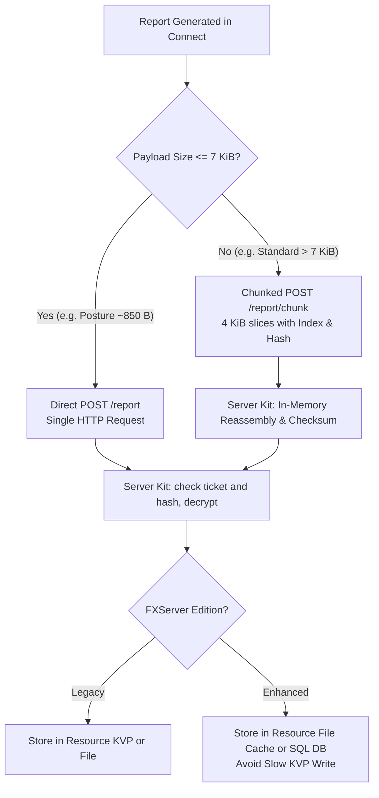

# ADR 0089 — Rongroi product line and schema 2

- Status: proposed — the owner decided the product-line questions Q1–Q23 on 2026-10-28, and PoC Spike W1a reported on 2026-10-31. It becomes accepted when the owner merges this ADR. Spike lanes S2 (NUI file picker), S4 (latent event from a client), S6 (deferrals card) and S11 (other antivirus) have not run; the points that depend on them are marked unverified
- Date: 2026-10-31 (revised 2026-11-01)
- Related: ADR 0002 (no verdicts / evidence only), ADR 0007 (official builds and provenance), ADR 0012 (relaunch elevated), ADR 0040 (player controls client machine), ADR 0061 (anchors and trace ages), ADR 0073 (saved reports and schema 1), AGENTS.md hard rule 1 (zero network in aeterna-rongroi), hard rule 3 (evidence, never a verdict), hard rule 9 (no verified badge / no auto-ban)
- Amends: ADR 0073 (extends `SavedRecord` to `schema: 2`, additive and backward-compatible)

## Context

Rongroi was originally designed and built as a single standalone desktop tool: **Rongroi Offline** (Tauri + Rust core). In this mode, players run the application locally or during a screenshare session, review the findings on screen, and optionally export a local saved report JSON (`SavedRecord`, schema 1, ADR 0073) without any network transmission.

### The Problem

Game communities running FiveM servers (both Legacy FXServer and Enhanced FXServer) need a mechanism to collect a record of a player's system state and investigate suspected game manipulation without forcing players through cumbersome manual screenshares or external third-party file uploads, and without giving server administrators intrusive, unverifiable kernel rootkits.

However, expanding Rongroi to communicate with servers introduces critical security, architectural, and data-sovereignty constraints:

1. **The Zero-Network Boundary (Hard Rule 1):** The core analysis engine and the offline desktop application MUST NOT contain any network code. Players who use Rongroi Offline must remain 100% certain that no data leaves their machine.
2. **The Client Control Boundary (ADR 0040 & Hard Rule 9):** The player controls their own Windows operating system and user-space environment. A client application can be hooked, modified, or replayed. Therefore, **no client can ever issue a "clean" or "verified" verdict.** Reports must consist strictly of objective forensic observations.
3. **The Paired-Origin Isolation Boundary:** If an automated client sends data to a server, it must be cryptographically and strictly bound to the specific server the player agreed to connect to. It must never phone home, send telemetry, or contact unauthorized third-party hosts.
4. **The Runtime Buffer Reality (Spike W1a Empirical Evidence):** PoC Spike W1a measured FXServer HTTP handling and discovered that while Legacy FXServer (master 35245) accepts 1 MiB HTTP payloads in a single request, Enhanced FXServer (early-access b170) enforces a strict **8,192-byte (8 KiB)** buffer limit. Any payload of 8,193 bytes or larger causes Enhanced FXServer to abort the connection with an empty reply (curl error 52).

## Decision

### 1. The Three-Tier Product Line

The Rongroi ecosystem is partitioned into three distinct, decoupled products with clear operational boundaries:

```
┌─────────────────────────────────────────────────────────────┐
│ 1. Rongroi Offline (repo: aeterna/aeterna-rongroi)          │
│    • Tauri desktop app + CLI                                │
│    • Zero network code (Hard Rule 1)                        │
│    • Local inspection & Schema 1 / Schema 2 export          │
└─────────────────────────────────────────────────────────────┘
                               ▲
                               │ shared core crate (read-only)
                               ▼
┌─────────────────────────────────────────────────────────────┐
│ 2. Rongroi Connect (repo: aeterna/aeterna-rongroi-connect)  │
│    • Standalone single-shot Electron client                 │
│    • Sandboxed Chromium UI (User privileges)                │
│    • Rust scan sidecar (rongroi-scan)                       │
│    • Inter-process Communication via Windows Named Pipe     │
│    • Network gate strictly locked to paired server origin   │
└─────────────────────────────────────────────────────────────┘
                               │
                               │ HTTP POST (Single-shot / Chunked)
                               ▼
┌─────────────────────────────────────────────────────────────┐
│ 3. Rongroi Server Kit (repo: aeterna/nakara-oss)            │
│    • FiveM resource: `nakara_rongroi` (MIT)                 │
│    • Operates on Legacy (:30130) & Enhanced (:30140)        │
│    • Issues pairing tickets & server policy                 │
│    • Ingestion: Direct (≤ 7 KiB) or Chunked (> 7 KiB)       │
│    • Rule evaluation, hash comparison, staff UI             │
└─────────────────────────────────────────────────────────────┘
```

1. **Rongroi Offline (`aeterna/aeterna-rongroi`):** Remains strictly offline. No network crates in `Cargo.lock`. Produces and reads both Schema 1 and Schema 2 reports.
2. **Rongroi Connect (`aeterna/aeterna-rongroi-connect`):** A lightweight single-shot client (Electron 44 + `rongroi-scan` sidecar). Connect runs with non-elevated user privileges, handles one case per run: it accepts a pairing code, shows the server and the scan scope, asks for consent, runs the sidecar, shows the `visual_hash`, sends the report to the paired server origin when the player presses Send, and then exits.
3. **Rongroi Server Kit (`nakara_rongroi` in `aeterna/nakara-oss`):** An open-source FiveM resource that integrates with server frameworks (Qbox, QBCore, ESX, or standalone). It mints short-lived, single-use pairing tickets, receives encrypted reports over HTTP, checks the ticket, nonce, expiry and report hash, and provides in-game staff inspection without automated bans.

### What Connect can and cannot show

The player controls the PC (ADR 0040), so a report from Connect can always be forged or edited before it is encrypted. Nothing in this ADR signs a report, and no part of it may be described as proof that a report is genuine or that a PC is clean (hard rule 9). Connect and Server Kit establish two facts only:

1. **The server received this upload after it opened this case** — the upload authenticates with the ticket the server issued, inside the ticket's 300-second window, and the ticket can be used once (section 5).
2. **The `visual_hash` the server recomputes equals the value in the record** — staff may compare it with the 16 characters the player reports from the screen (section 2). A player who controls Connect can show or choose any value, and 64 bits is sized for people comparing, not for collision resistance.

The uploader is not identified. Anyone who holds the pairing code can upload with it; nothing binds the ticket to the player's game session or address.

---

### 2. Schema 2 (Record Model Evolution in `rongroi-core`)

The top-level saved record (`crates/rongroi-core/src/view/saved.rs`) is upgraded from `schema: 1` to `schema: 2`. The evolution is strictly additive: existing schema 1 records deserialize without error (missing fields default to `None`).

A Schema 2 record has the following shape:

```json
{
  "kind": "rongroi-saved-report",
  "schema": 2,
  "case_code": "7K9M-2X4P",
  "rongroi_version": "0.14.0",
  "official_build": true,
  "producer": {
    "name": "rongroi-connect",
    "version": "0.1.0",
    "mode": "single-shot"
  },
  "binding": {
    "server_origin": "http://203.0.113.10:30130",
    "ticket": "9f82c4e1b07a412891d604e38a291bf0",
    "nonce": "c4b82e91024a",
    "issued_at": "2026-10-31T14:30:00Z",
    "expires_at": "2026-10-31T14:35:00Z"
  },
  "policy": {
    "profile": "posture",
    "required_collectors": [
      "posture",
      "os_image",
      "install_marker",
      "defender_exclusion",
      "net_config",
      "driver_service"
    ],
    "require_elevation": true,
    "server_name": "Example City",
    "policy_hash": "a1b2c3d4e5f60718"
  },
  "visual_hash": "4f8a91bc023e5d71",
  "view": { "...": "Standard view payload as in Schema 1" }
}
```

#### Field Specifications:

* **`producer` (Optional in Schema 1, Required in Schema 2):**
  - `name`: `"rongroi-offline"` or `"rongroi-connect"`
  - `version`: Version string of the producer binary
  - `mode`: `"interactive"` (the Offline app, the player navigates freely) or `"single-shot"` (Connect: one case per run, with consent and a Send button)
* **`binding` (Optional in Schema 1, Present when produced via Connect):**
  - `server_origin`: The exact HTTP/HTTPS origin (`scheme://host:port`) of the paired FiveM server.
  - `ticket`: A 32-character hexadecimal cryptographically secure random token generated by Server Kit.
  - `nonce`: a server-generated value echoed from the pairing code. The player holds it, so it ties the record to the case; it does not prove when the scan ran.
  - `issued_at` & `expires_at`: ISO 8601 UTC copies of the ticket's lifetime (300 seconds). Server Kit enforces expiry by its own clock and its own record of the ticket, never by these fields.
* **Fields the report states about itself:** `official_build`, `producer`, `rongroi_version`, `issued_at` and `expires_at` are written by the producer. Staff screens label them "the report says".
* **`policy` (Optional in Schema 1, Present when produced under Server Kit policy):**
  - `profile`: one of three names, each fixing what `required_collectors` may hold:
    - `"posture"` — the collectors behind the rules marked `posture` (machine requirements a server may gate on, Q18), plus the collectors an accepted ADR names as read beside those rules (ADR 0090, proposed, would name `antivirus_product`). The example above lists them as of this ADR.
    - `"standard"` — the same collectors the Offline app runs in a full scan of the same `rongroi_version`.
    - `"custom"` — a list the server picks from the collector IDs that `rongroi_version` knows. An unknown ID makes Connect refuse the policy before the consent screen.
    Whatever the profile, Connect shows the full collector list on the consent screen, and the record carries the list that ran.
  - `required_collectors`: Array of collector IDs requested by the server and consented to by the player.
  - `require_elevation`: Boolean indicating whether administrator elevation was mandated.
  - `server_name`: the name shown on the consent screen. It is inside the policy so `policy_hash` covers it.
  - `policy_hash`: 16-hex digest of the policy definition (section 5).
* **`visual_hash`:**
  - 16 lowercase hexadecimal characters: the first 64 bits of `SHA-256(C)`, where `C` is the record with the `visual_hash` member removed, serialized by the JSON Canonicalization Scheme (RFC 8785) and encoded as UTF-8. Removing the member first keeps the hash from covering itself.
  - Producer and server compute it the same way; the server recomputes it from the decrypted record and stores a mismatch as a fact on the case, never as a verdict.
  - 64 bits is sized for a person comparing two screens, not for collision resistance. Integrity of the upload in transit is checked separately with the full SHA-256 (section 4).
  - Displayed prominently in the Connect window before upload, and displayed on the staff inspection UI and in-game NUI, allowing visual confirmation during screenshares or support reviews.

---

### 3. Connect Security Architecture & IPC Boundary

1. **Separation of Privilege:**
   - The user-facing Electron shell (`rongroi-connect.exe`) runs as a standard, non-elevated user process. It does NOT request or require UAC elevation.
   - When policy requires administrative privileges (specifically for the `defender_exclusion` collector, or standard USN/event collectors), the shell invokes the sidecar (`rongroi-scan.exe`) with the `--elevate` flag using the established `elevate::relaunch_elevated` mechanism (ADR 0012).
   - If the player declines UAC (clicks "No"), the sidecar immediately terminates with exit code 3 (`declined`). Connect intercepts this code and reports `{ "scan": "declined" }` to the server without freezing or timing out. The player may also decline on the consent screen, before any scan; Connect sends the same answer. The answer travels in the envelope of section 5 to `POST /<resource>/report`, like a report.
2. **Local IPC via Windows Named Pipe:**
   - Data transfer between the elevated sidecar and non-elevated Connect occurs strictly in memory over a random named pipe: `\\.\pipe\rongroi-<32hex>`. Connect creates the pipe and passes `binding` and `policy` over it; the sidecar builds the whole Schema 2 record with `rongroi-core`, `visual_hash` included, and writes it back. The ticket never appears on a command line.
   - The pipe security descriptor (ACL) restricts access exclusively to the current user SID and administrative tokens, rejecting remote connections (`PIPE_REJECT_REMOTE_CLIENTS`).
   - No report is written to disk. Chromium's caches go to a temporary userData folder under `%TEMP%` that Connect deletes on exit (Connect ADR 0001 section 3), instead of the ~10 MB S12 found under `%APPDATA%`; which files remain after exit is recorded in lane 2c before 0.1.0.
3. **Network Quarantine:**
   - In production builds of Connect, Chromium's network stack is quarantined. The full list, and the CI job that proves it, live in Connect ADR 0001 section 2. S7 found these three necessary:
     - `no-proxy-server` stops the WPAD DNS lookup.
     - `setSpellCheckerLanguages([])` and a spellcheck dictionary URL of `127.0.0.1:9` stop the dictionary download.
     - `webRequest.onBeforeRequest` blocks any outgoing HTTP/HTTPS/WebSocket request whose origin differs from `binding.server_origin`.

---

### 4. Server Ingestion Protocol (Handling the 8 KiB Buffer Limit)

So that one protocol fits under Enhanced's body limit and still carries larger reports, ingestion has two modes:



What travels is the encrypted envelope of section 5, not the plain JSON, and the size test below applies to the envelope.

1. **Small Payload Path (Size &le; 7,168 bytes):**
   - Connect issues a single `POST /<resource>/report` containing the complete envelope, with headers `X-Rongroi-Upload-Id` (the ticket) and `X-Rongroi-Report-Sha256` (64 hex, SHA-256 of the envelope bytes). Server Kit needs the ticket before it decrypts, because the ticket is the HKDF salt and the additional data.
   - Fits under Enhanced's 8,192-byte limit. Whether that limit counts headers was not measured (S1 sent bodies).
2. **Large Payload Path (Size > 7,168 bytes):**
   - Connect splits the payload into slices of 4,096 bytes (4 KiB).
   - Slices are uploaded sequentially to `POST /<resource>/report/chunk` with headers:
     - `X-Rongroi-Upload-Id`: Pairing ticket.
     - `X-Rongroi-Chunk-Index`: 0-based slice index.
     - `X-Rongroi-Chunk-Total`: Total slice count.
     - `X-Rongroi-Chunk-Sha256`: Hash of current slice.
     - `X-Rongroi-Report-Sha256`: SHA-256 of the whole envelope, the same value on every slice.
   - If any slice fails due to network jitter, Connect retries up to 3 times with exponential backoff (500 ms, 1500 ms, 3000 ms).
   - Server Kit reassembles slices in memory, keyed by ticket and `Report-Sha256`. A buffer is dropped after 60 seconds with no new slice (an idle limit, not a total). At most two uploads may be open per ticket; the first to authenticate consumes the ticket and the other is dropped (section 5).
   - When the last slice arrives, Server Kit checks the SHA-256 of the reassembled envelope against `X-Rongroi-Report-Sha256` before it decrypts. A mismatch drops the buffer and answers `422`; Connect may restart the upload while the ticket is still valid.
3. **Status codes** (Server Kit and Connect both follow this table):

   | Code | Meaning | Connect retries |
   |---|---|---|
   | `200` | accepted, or slice stored; also a repeat of the exact envelope already accepted (same `Report-Sha256`) | — |
   | `400` | malformed headers or envelope | no |
   | `404` | unknown ticket | no |
   | `409` | ticket consumed by a different envelope | no |
   | `410` | ticket expired | no |
   | `413` | over a size limit | no |
   | `422` | hash mismatch, or the envelope does not authenticate | restart the upload while the ticket is valid |
   | `429` | rate limited, with `Retry-After` | after `Retry-After` |

   A direct `POST` whose reply is lost is retried like a slice; the `200` on a repeat makes that safe.
4. **Server-Side Storage Strategy:**
   - **Legacy FXServer:** Reports may be stored in Resource KVP (write latency measured at 17–27 ms).
   - **Enhanced FXServer:** Reports MUST NOT be written synchronously to Resource KVP (write latency measured at 192–222 ms due to SQLite disk sync). Server Kit writes the decrypted, validated record to a file in its own resource folder (`<resource>/cache/rongroi-reports/<ticket>.json`, because `SaveResourceFile` writes only inside the resource folder; its write latency on Enhanced is unverified and measured in lane 2b) or asynchronously into the server database (`oxmysql`, used only when the server runs it; nakara-oss hard rule 5 must allow it first).

---

### 5. Pairing, Encryption and the Single-Use Ticket

The owner decided (Q8) that reports are encrypted at the message level with a key of the Server Kit that travels inside the pairing code, and that Cfx's HTTPS is used only if the spike shows it works. Spike W1a did not test HTTPS through `users.cfx.re` (S1 fell back to message-level encryption only), so v1 sends the encrypted envelope over plain HTTP to `server_origin`.

1. **Server Kit key pair:** Server Kit creates an X25519 key pair when it first starts and keeps the private key in its own resource storage. The private key never leaves the server.
2. **Pairing code:** when staff open a case (or at a deferrals check), Server Kit shows the player a code in game: `rr1.` followed by base64url of a small JSON object holding `server_origin`, `ticket`, `nonce`, `expires_at`, `policy_hash` and the Kit's public key. The player copies and pastes it; it is not meant to be typed. Unverified: that the in-game screen or the deferrals card (S2, S6 not run) lets the player copy it; lane 3b provides a fallback. Because the code reaches the player inside the game, a party on the network path cannot swap the key without also controlling the game client. `server_origin` must be an address the player's PC can reach directly; a server that hides its address behind the Cfx proxy cannot use v1.
3. **Policy fetch:** Connect reads the policy with `GET /<resource>/policy/<ticket>` from `server_origin` — the first request it makes — and refuses it unless its digest equals `policy_hash` from the code. `policy_hash` is the first 64 bits of SHA-256 over the RFC 8785 serialization of the `policy` object without its `policy_hash` member. The consent screen shows `server_origin`, the server name from the policy and the full collector list before anything runs.
   - **A pasted code is untrusted input.** A code posted outside the game (a chat scam) would point Connect at any address. Connect shows the origin prominently with the line "only paste a code from the game", accepts only `http`/`https` origins without user info, follows no redirect, and treats loopback and private-range origins as the Connect ADR decides.
4. **Envelope:** Connect creates a fresh X25519 key pair per report, derives a key with HKDF-SHA256 (salt = the ticket as its 32-character lowercase hex ASCII string; info = `rongroi-connect report v1` followed by the Kit's public key and `epk`, 32 bytes each) and encrypts the UTF-8 record with AES-256-GCM, with the same ticket string as additional data. Lane 2b publishes a test-vector file that Server Kit and Connect both test against. The envelope is `{ "v": 1, "epk": …, "iv": …, "ct": … }` (base64url members). Node's `crypto` module is present in both FXServer editions (S3); X25519 and AES-GCM specifically were not exercised in the spike and are checked first in W2.
5. **Single-use ticket:** the states are `issued`, `uploading`, `consumed` and `expired`.
   - `issued → uploading` when Server Kit accepts a direct `POST` or a first slice, only while the server's clock is before `expires_at`. An upload that started in time may finish while its buffer stays within the idle limit.
   - `uploading → issued` when every open buffer for the ticket is dropped: idle limit reached, `422`, or an envelope that does not authenticate. A failed upload never consumes the ticket.
   - `→ consumed` only when an envelope authenticates (AES-GCM succeeds) and the record's nonce equals the one issued, for a report or a `{ "scan": "declined" }` answer. Only an authenticated envelope changes the ticket to `consumed`.
   - `issued → expired` at `expires_at` by the server's clock.
   - Any upload for a consumed ticket gets `409`, unless it repeats the accepted envelope (`200`), and is logged on the case. Staff open a new case to scan again.
6. **Two paths, two rules.**
   - **Connect path:** schema 2 with `binding` required; the nonce must match.
   - **Saved-file path** (Server Kit's upload page, a file the Offline app saved): schema 1 or 2; `binding` and nonce are not checked, because the file was not made for this case. The ticket still binds the upload, as the envelope's additional data. Server Kit labels the case "uploaded from a saved file", shows when the server received the file and not when the scan ran, and never lets it satisfy a gate. Schema 1 has no `visual_hash`; Server Kit computes one for its own records, and there is nothing on the player's screen to compare it with. When the Offline app saves a schema 2 file, it shows the file's `visual_hash` (lane 2a).

---

## Consequences

### Positive
- **Integrity of Offline Preserved:** `aeterna-rongroi` maintains its zero-network invariant.
- **Cross-Edition Compatibility:** one protocol is designed to fit both editions' limits. Measured only on Enhanced b170 and Legacy master 35245 with a plain JSON posture record and no encryption; the chunked path and the envelope are untested.
- **Traceability, not proof:** the ticket, nonce and `visual_hash` let staff tie an upload to the case they opened and to the value the player reports from the screen. They do not show that the report is genuine; the player can still forge it (section 1, "What Connect can and cannot show").
- **Fast Execution:** in S13 the posture path (window ready, scan, pipe, one POST) took 1.31–1.35 s without encryption, consent or a person; S12's whole flow including open and close took 4.1–5.2 s.

### Negative & Mitigations
- **Binary Footprint:** Electron packaging adds ~158 MB (compressed zip) for the Connect client. Mitigation: distributed as a portable zip archive with fast extraction (6.4 s).
- **Distribution is a zip, not an installer or a self-extracting exe** (owner, in session on 2026-11-01): Electron ships as a folder (387 MB, 74 files in S12), so it cannot be one exe like Offline. A self-extracting portable exe unpacks the whole app into `%TEMP%` on every launch before the window opens. An installer is a downloaded exe too, so SmartScreen warns on it the same way, and it adds files under Program Files, registry keys and an uninstall entry that the single-shot flow does not need. No rule forbids an installer; the persistent mode the owner deferred (Q17) revisits this choice in its own ADR. The player's steps follow the Offline guide: download the zip from Releases, check its SHA-256 against `SHA256SUMS` with `certutil` in Command Prompt, then **Unblock** the zip (Properties) before extracting it, so the extracted files do not carry the Mark-of-the-Web. Extracting a marked zip with Windows' own extractor passes the mark to the files inside. Unverified: that unblocking the zip leaves `rongroi-connect.exe` unmarked on Windows 11 — the owner downloads the zip in a browser on a test PC once in W4, before the Connect guide is written. The guide does not suggest third-party extractors as a way around the warning.
- **Unsigned releases and SmartScreen:** a file downloaded in a browser carries the Mark-of-the-Web, and SmartScreen warns on such a file until it has reputation; since August 2024 an EV certificate no longer grants that reputation at once (`docs/research/05-oss-rust-tauri-repo-practices.md`). Spike S10 copied the exe over scp, without the mark, so the browser-download path is untested. Rongroi Offline ships unsigned today and its guide tells players to click **More info → Run anyway** (`docs/screenshare-guide.md`); Connect 0.1.0 pre-alpha follows the same path. Signing through SignPath Foundation waits for a second maintainer who can act as release approver (`GOVERNANCE.md`); a paid certificate is an owner decision.
- **Encryption without HTTPS:** v1 hides report content with the envelope of section 5, but the request line, headers and the policy response travel in clear over HTTP: resource path, ticket, sizes, the policy and the server name.
- **An observer on the path can disturb an upload.** Seeing the ticket, they can open uploads with junk envelopes. They cannot consume the ticket, because only an authenticated envelope does; the second open upload slot lets the real one finish. They can still delay an upload until the ticket expires.
- **A leaked Kit private key** decrypts every upload recorded under that key; the key is static until staff rotate it.
- **The saved-file upload page has no integrity over HTTP.** An attacker on the path can change the page's own code and read the saved report before it is encrypted. Server Kit ADR 0001 keeps the page off by default until HTTPS is available.
