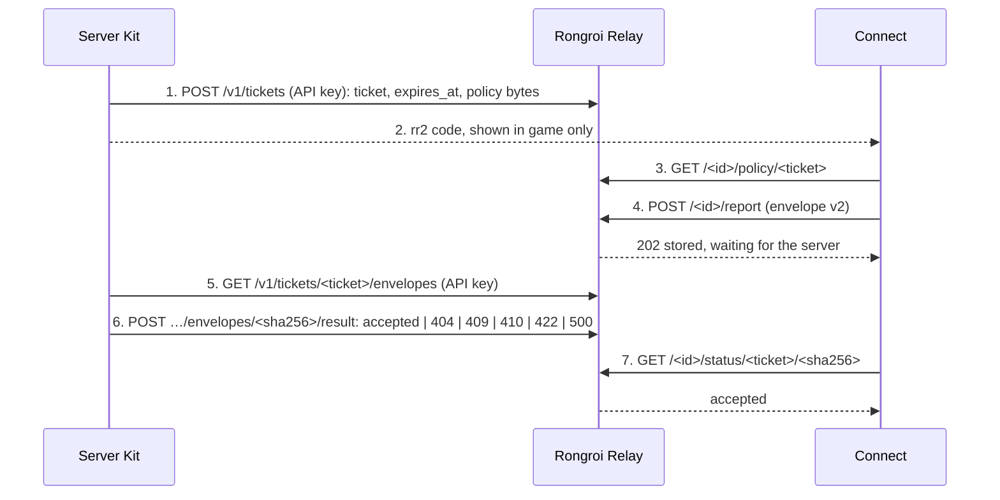

# ADR 0097 — Easy adoption for any server: rr2 codes, Rongroi Relay and envelope v2

- Status: accepted — the owner decided plan questions Q1–Q7 and, after plan scrutiny, R1–R6 on 2026-11-21, each as
  recommended
- Date: 2026-11-21
- Amends: ADR 0089 §4 (a second transport besides the direct upload) and §5 (a second code format and envelope
  version). Connect ADR 0002 keeps its argv rule and gains exit code 17 (Connect ADR 0003). Server Kit ADR 0001 is amended in its own repository.
- Plan: https://claude.ai/artifact/1DX1TpQ6EXf2vixS6dbB26 (status table, flows, scrutiny findings)

## Context

A server that is not Nakara can adopt the Connect path today only if it looks like Nakara:

1. Connect sends every request under the fixed path `/nakara_rongroi/` (Connect `src/main/net.js:8`), and its parser
   accepts only `rr1.` codes with exactly six members (Connect `src/core/pairing.js:157-178`).
2. Reports go over plain HTTP straight to the game server's port. A server behind the Cfx proxy cannot use it, there
   is no HTTPS, and Enhanced (b170) drops bodies of 8,193 bytes or more (§4).
3. The Server Kit is configured only in game, and Server Kit ADR 0001 says it reads no convar.
4. Other games or frameworks have no library for the envelope; it lives inside the Kit's JavaScript.

The owner asked for a version any developer can plug in. Plan scrutiny (2026-11-21) rejected two parts of the first
draft, which this ADR records so they are not proposed again:

- **A relay that only stores ciphertext cannot keep a ticket single-use.** The Kit consumes a ticket only after the
  envelope authenticates and the record's nonce matches (§5.5). A relay that cannot decrypt either accepts the first
  upload, so anyone holding the code can burn the ticket with junk, or accepts every upload. Connect would also say
  "Sent" on a relay's `2xx` although the game server never accepted the report.
- **A deep link that carries the code** (`rongroi://pair?c=…`) puts the ticket on argv, which Connect ADR 0002 §3
  forbids, and delivers codes from outside the game, which §5.3 warns players against. Dropped (owner, R1).

## Decision

### 1. Two transports

| | `direct` | `relay` |
|---|---|---|
| Where Connect sends | the game server's own origin (today's path) | a Rongroi Relay the server owner runs |
| Code | `rr1.` while the resource is `nakara_rongroi`; `rr2.` otherwise | `rr2.` |
| Envelope | v1 (§5.4) | v2 (section 4 below) |
| Size rule | §4: direct `POST` ≤ 7,168 bytes, else 4 KiB slices | one `POST`, ≤ 2 MiB |
| HTTPS | only if the server provides it | required |
| Game server needs an inbound port | yes | no: the Kit pulls from the Relay |

The direct transport stays as it is. A Kit issues `rr1.` whenever it can, so Connect 0.1.1 keeps working with every
direct server that has not renamed the resource.

AETERNA runs no relay (owner, Q1 and R5). A server owner who wants the relay transport runs one: on the game server's
machine on port 443, on a small VPS, or on a container service. The image and a Compose example with a TLS proxy are
published with the Server Kit (MIT).

### 2. The `rr2.` code

`rr2.` followed by base64url (no padding) of a JSON object with exactly these eight members:

| Member | Rule |
|---|---|
| `server_origin` | where Connect sends: `https://host[:port]` for `relay`; `http`/`https` origin for `direct`. No path, as for rr1 |
| `base_path` | one path segment, `^[a-z0-9_-]{1,64}$`. Direct: the Kit's resource name. Relay: the server's id on that Relay |
| `transport` | `"direct"` or `"relay"` |
| `ticket`, `nonce`, `expires_at`, `policy_hash`, `kit_public_key` | as in rr1 (§5.2) |

Connect checks `base_path` and `transport` with the same quarantine it applies to the origin, refuses unknown members,
and builds every URL as `server_origin + "/" + base_path + "/…"`. Connect accepts `rr1.` throughout 0.x.
The Kit issues only an origin that equals `new URL(origin).origin` (lower case, no default port), so the string in the
code is the one both sides use. On a Relay, `v1` is reserved and cannot be a `base_path`.

### 3. The relay protocol

1. **Registration.** Before it shows a code, the Kit registers the ticket with its `expires_at` and the exact policy
   bytes. The Relay serves those bytes unchanged, so their digest still equals `policy_hash`. An upload for a ticket
   that was not registered gets `404`.
2. **Upload.** The Relay checks only what it can: registered ticket, not expired, size ≤ 2 MiB,
   `X-Rongroi-Report-Sha256` equals the body, rate limits. It stores the envelope and answers `202`. A ticket holds at
   most 3 envelopes that are pending or accepted; another gets `409`. An envelope the Kit answers with `422` is deleted
   and frees its slot, so junk uploads cannot lock the player out. Uploads per address are rate-limited. A repeat of a
   stored envelope gets the same answer as the first.
3. **Pull and result.** The Kit pulls pending envelopes, decrypts, checks binding and nonce as in §5.5, stores the
   record, and posts a result per envelope: `accepted`, `404` (the Kit no longer knows the ticket, for example after a
   restart), `409`, `410`, `422` or `500`. A result is final: Connect does not restart or retry the upload. `accepted` consumes the ticket at the
   Relay: later uploads get `409`, except a repeat of the accepted envelope, which gets `200` as in §4.
4. **Status.** Connect polls `status` until it reads a result. It shows "Sent" only for `accepted`. Until then it shows
   "Delivered to the relay, waiting for the server", and after `expires_at` plus 10 minutes with no result, "The relay
   has the report but the server has not confirmed it" — never "Sent".
5. **Uploader address.** The Kit records the uploader's address as evidence (Server Kit ADR 0001). The Relay takes it
   from the socket, or from `X-Forwarded-For` only when the socket peer is in its configured trusted proxies, and passes
   it to the Kit labelled with its source (`socket` or `forwarded`). The Kit shows it as "reported by the relay".
6. **Retention.** The Relay deletes an envelope when the Kit's result is `accepted` and the Kit has stored the record,
   when the ticket is deleted (`DELETE /v1/tickets/<ticket>`, sent when staff delete the case), or one hour after
   `expires_at` if no result came. The result word (not the envelope) is kept until `expires_at` plus 10 minutes so
   Connect can read it. The Kit's retention rules govern the record.
7. **Keys and servers.** One Relay can serve several game servers. Each has an id (`base_path`) and an API key; the
   Relay stores only the key's SHA-256. The Kit reads the key from a server-only convar (`set`, never `setr`).
8. **Status endpoint.** Unauthenticated, rate-limited, and it returns only the result word for one ticket and hash.
9. **No verdict.** The Relay has no endpoint that says whether a PC passed. Results describe the upload, not the PC.

### 4. Envelope v2

Envelope v2 is v1 (§5.4) with two changes. The envelope body carries `"v": 2`; the header `X-Rongroi-Envelope: 2`
only helps routing and is not trusted:

- HKDF `info` starts with `rongroi-connect report v2` instead of `… v1`.
- The AES-GCM additional data is no longer the ticket alone but the JCS form of
  `{ "base_path", "policy_hash", "server_origin", "ticket", "transport" }`, using the exact strings of those members
  in the code. The Kit stores all five values with the ticket when it issues the code.

A Kit decrypts with the values it issued, so a code edited to point at another origin or relay fails to authenticate
(`422`). A ticket issued as `rr1` accepts only v1; a ticket issued as `rr2` (direct or relay) accepts only v2. Test vectors for v2 are published next to
`test-vectors/envelope-v1.json` before any implementation merges.

### 5. Connect's consent screen

"Where the data goes" keeps showing `server_origin`'s host. For `relay` it adds one line: "Through a relay the server
runs; the game server collects it from there." `server_name` is chosen by the Kit and is not shown as a fact about the
destination. The line "only paste a code from the game" stays.

### 6. Distribution (owner, R2)

Connect stays a zip (the owner's decision of 2026-11-01, §Negative). It is also offered through a winget manifest that
points at the same release zip, and is signed through SignPath Foundation once the project has a second maintainer.
No installer and no paid certificate in this round.

### 7. Libraries

- `@aeterna/rongroi-envelope` (npm, MIT) is extracted from the Server Kit's JavaScript, which is MIT already.
- A Rust crate is written from this ADR and the test vectors, not adapted from Connect's or rongroi's GPL code, so it
  can be MIT.
- rongroi's own crates stay `publish = false`.

## Consequences

### Positive

- A server behind the Cfx proxy, a server that wants HTTPS, and a game that is not FiveM can use the Connect path.
- The relay transport needs no inbound port on the game server and has no 8 KiB limit.
- A junk upload cannot consume a ticket: only the Kit's `accepted` does, and a ticket holds at most 3 envelopes.
- Connect 0.1.1 keeps working with direct servers that keep the resource name.

### Negative and mitigations

- **Another service to run.** Optional: direct stays. The Compose example and the quickstart cover TLS and backups.
  Hosting cost is not measured yet.
- **The Relay sees metadata** (ticket, sizes, times, uploader address) but not the record. The quickstart says so.
- **Reports are still unsigned (ADR 0040).** Anyone holding a code can upload; the 3-envelope limit bounds the damage.
- **Not verified:** the response size `PerformHttpRequest` accepts when the Kit pulls an envelope (pulling may need
  ranges or slices); HTTPS through `users.cfx.re`.
- Renaming the Kit's resource is not supported in Kit 0.2: its key and settings live in per-resource storage. `rr2`
  carries `base_path` so a later Kit can support it.
